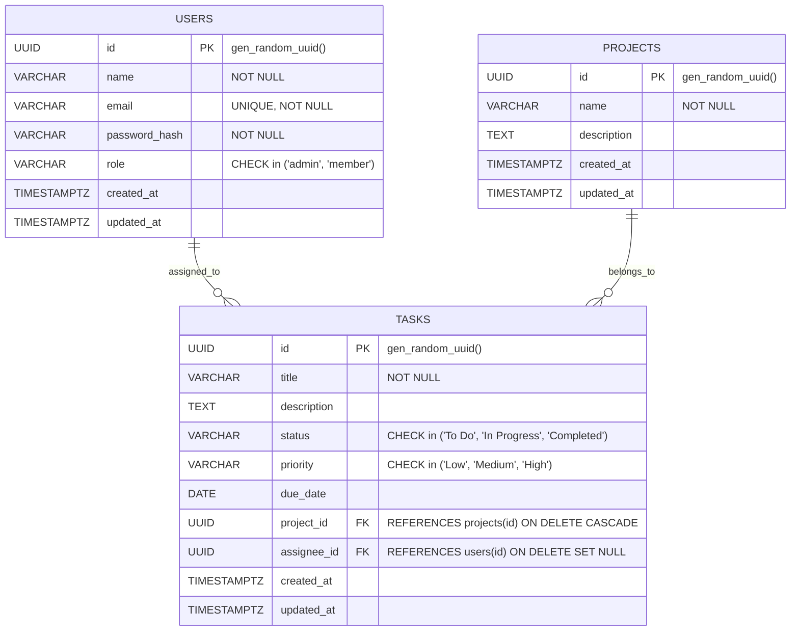

# Smart Task & Project Management System

[](https://nodejs.org/)
[](https://expressjs.com/)
[](https://www.postgresql.org/)
[](https://react.dev/)
[](https://vitejs.dev/)
[](https://opensource.org/licenses/MIT)

An enterprise-grade, full-stack Task and Project Management platform developed for the **Bright Mind Ltd. Full-Stack Developer Assessment**. Designed with a performance-first PostgreSQL schema, secure JWT Role-Based Access Control (RBAC), single-query analytical metrics, and a polished Midnight Navy executive UI.

---

## Table of Contents
- [System Architecture](#system-architecture)
- [Key Features](#key-features)
- [Tech Stack](#tech-stack)
- [Database Schema & Design](#database-schema--design)
- [Pre-Seeded Accounts](#pre-seeded-accounts)
- [Getting Started](#getting-started)
  - [Prerequisites](#prerequisites)
  - [Backend Setup & Database Migration](#1-backend-setup--database-migration)
  - [Frontend Setup](#2-frontend-setup)
- [Running Automated Tests](#running-automated-tests)
- [API Overview](#api-overview)
- [Project Structure](#project-structure)
- [Assessment Deliverables](#assessment-deliverables)

---

## System Architecture

```mermaid
graph TD
    Client["React 19 SPA (Vite)"]
    Router["React Router v7"]
    AuthCtx["Auth Context (JWT State)"]
    Axios["Axios API Client (Bearer Interceptor)"]
    
    API["Express 5 REST API (:5000)"]
    AuthMW["JWT & RBAC Middleware"]
    ValMW["Validation & Sanitization Middleware"]
    ErrMW["Centralized DB Error Handler"]
    
    DB[(PostgreSQL 17 :5432)]
    
    Client --> Router
    Router --> AuthCtx
    AuthCtx --> Axios
    Axios -->|HTTP + Bearer Token| API
    
    API --> AuthMW
    AuthMW --> ValMW
    ValMW --> Controllers["Controllers (Auth, Projects, Tasks, Dashboard)"]
    Controllers --> ErrMW
    Controllers -->|pg.Pool (Parameterized SQL)| DB
```

---

## Key Features

### 1. Robust Authentication & RBAC
- **Password Security**: Passwords hashed using `bcrypt` (10 salt rounds).
- **Session Tokens**: Stateless JSON Web Tokens (JWT) signed with HMAC-SHA256 and expiration.
- **Role Enforcement**:
  - **`admin`**: Full administrative access — create/update/delete projects, assign tasks to any employee, manage task lifecycle, and view executive metrics.
  - **`member`**: Focused team access — view projects (read-only), view tasks, and independently update task completion status (`To Do` -> `In Progress` -> `Completed`) on their assigned work.

### 2. Project Portfolio Management
- Real-time dynamic completion percentage computation (`COUNT(*) FILTER (WHERE status = 'Completed') / total * 100`).
- Relational cascading deletion (`ON DELETE CASCADE`) to eliminate orphaned task records upon project deletion.

### 3. Advanced Task Lifecycle & Filtering
- Categorized by **Status** (`To Do`, `In Progress`, `Completed`) and **Priority** (`Low`, `Medium`, `High`).
- **Multi-Field Real-Time Filtering**: Live server-side filtering combining project, status, priority, assignee, text search, and overdue toggles.
- **Relational Integrity**: Foreign key to assignees (`ON DELETE SET NULL`) preserves tasks when team members are removed.

### 4. Executive Dashboard & Metrics
- **Zero N+1 Roundtrips**: Aggregated in a **single database query** using SQL subqueries and conditional filtering (`total_projects`, `total_tasks`, `completed_tasks`, `pending_tasks`, `overdue_tasks`, `completion_rate`).
- **Overdue Task Tracking**: Immediate warning banner and dedicated view for tasks with past-due deadlines that are not yet completed.

### 5. Polished Executive UI
- Built on a **Deep Midnight Navy & Ice Slate** theme (`#0A1931` and `#F6FAFD`) designed for long-shift operational clarity.
- Fixed `100vh` non-scrolling sidebar and top navigation with independent scrollable data tables.
- Dot-style semantic badges and quick demo-fill buttons for instant reviewer evaluation.

---

## Tech Stack

| Layer | Technology | Key Libraries / Modules |
|---|---|---|
| **Frontend** | React 19, Vite 6 | `react-router-dom`, `axios`, `lucide-react`, Vanilla CSS Design Tokens |
| **Backend** | Node.js (v18+), Express 5 | `pg` (Connection Pooling), `jsonwebtoken`, `bcrypt`, `cors`, `dotenv` |
| **Database** | PostgreSQL 17 | Relational DDL, UUID v4 (`gen_random_uuid()`), Composite B-tree Indexes, Dynamic Interval Seeds |
| **Testing** | Node.js Test Runner | Custom Automated Integration Test Suite (`test-api.js`) |

---

## Database Schema & Design

The database schema is strictly normalized and enforced with database-level constraints:



### Strategic B-Tree Indexes
- `idx_users_email`: O(1) indexed lookup for authentication.
- `idx_tasks_project_id`: Fast join for project-specific task listings.
- `idx_tasks_assignee_id`: Fast filtering by team member.
- `idx_tasks_status`: Accelerated aggregation for dashboard metrics.
- `idx_tasks_due_date`: Instant overdue task detection.
- `idx_tasks_composite_filter`: Composite index on `(project_id, status, priority)` for multi-field search queries.

---

## Pre-Seeded Accounts

The database migration seeds **7 users**, **3 strategic projects**, and **14 tasks** (including 3 dynamically overdue tasks):

| Role | Name | Email | Password | Access Rights |
|---|---|---|---|---|
| **Admin** | Alex Turner | `alex.admin@brightmind.com` | `password123` | Full administrative control (CRUD projects, tasks, view all metrics) |
| **Admin** | Sarah Jenkins | `sarah.lead@brightmind.com` | `password123` | Full administrative control |
| **Member** | John Smith | `john.dev@brightmind.com` | `password123` | Task status updates, view projects & assigned work |
| **Member** | Emily Davis | `emily.design@brightmind.com` | `password123` | Task status updates, view projects & assigned work |
| **Member** | Michael Scott | `michael.qa@brightmind.com` | `password123` | Task status updates, view projects & assigned work |
| **Member** | Rachel Green | `rachel.fe@brightmind.com` | `password123` | Task status updates, view projects & assigned work |
| **Member** | David Kim | `david.sec@brightmind.com` | `password123` | Task status updates, view projects & assigned work |

> **Note**: Both test accounts are available via one-click **"Fill Demo"** buttons on the Login page.

---

## Getting Started

### Prerequisites
- **Node.js** v18.0.0 or higher ([Download](https://nodejs.org/))
- **PostgreSQL** v14 or higher ([Download](https://www.postgresql.org/))
- **Git** ([Download](https://git-scm.com/))

---

### 1. Backend Setup & Database Migration

1. **Navigate to the backend directory**:
   ```bash
   cd backend
   ```

2. **Install dependencies**:
   ```bash
   npm install
   ```

3. **Configure Environment Variables**:
   Create a `.env` file in the `backend/` directory (or modify the existing one):
   ```env
   PORT=5000
   NODE_ENV=development
   
   # PostgreSQL Connection Parameters
   DB_HOST=localhost
   DB_PORT=5432
   DB_NAME=bm_task_manager
   DB_USER=postgres
   DB_PASSWORD=postgres
   
   # JWT Security
   JWT_SECRET=super_secret_brightmind_jwt_key_2026_recruitment
   JWT_EXPIRES_IN=24h
   ```

4. **Initialize Database & Seed Data**:
   Ensure PostgreSQL is running locally and run the automated initialization script:
   ```bash
   npm run init-db
   ```
   *This command creates the database (if not existing), executes the DDL schema, applies performance indexes, and seeds realistic enterprise data with dynamic relative dates.*

5. **Start Backend Server**:
   ```bash
   npm run dev
   ```
   *The server will start at `http://localhost:5000` with PostgreSQL connected.*

---

### 2. Frontend Setup

1. **Open a new terminal and navigate to the frontend directory**:
   ```bash
   cd frontend
   ```

2. **Install dependencies**:
   ```bash
   npm install
   ```

3. **Start Vite Development Server**:
   ```bash
   npm run dev
   ```
   *The application will open at `http://localhost:5173`.*

---

## Running Automated Tests

An automated end-to-end integration test suite is included in the backend. It verifies all 8 core functional workflows against the live database:

1. In the `backend` directory, run:
   ```bash
   npm test
   ```

2. **Test Coverage**:
   - `[1/8]` User Authentication & JWT Issuance
   - `[2/8]` Current User Profile Verification (`/api/auth/me`)
   - `[3/8]` Project Creation (Admin authorization)
   - `[4/8]` Project Listing & Completion Metric calculation
   - `[5/8]` Task Creation linked to Project & Assignee
   - `[6/8]` Task Listing with Multi-Field Search & Filter
   - `[7/8]` Single-Query Dashboard Aggregation & Overdue Alert Check
   - `[8/8]` Project Cascading Deletion Verification (confirms child tasks are purged)

---

## API Overview

Base URL: `http://localhost:5000/api`

| Method | Endpoint | Access | Description |
|---|---|---|---|
| `POST` | `/auth/register` | Public | Register new user account |
| `POST` | `/auth/login` | Public | Authenticate user & return JWT |
| `GET` | `/auth/me` | Authenticated | Retrieve authenticated user profile |
| `GET` | `/auth/users` | Authenticated | Retrieve team members for task assignment |
| `GET` | `/projects` | Authenticated | List all projects with completion % |
| `GET` | `/projects/:id` | Authenticated | Get project details & associated tasks |
| `POST` | `/projects` | Admin Only | Create new project |
| `PUT` | `/projects/:id` | Admin Only | Update project details |
| `DELETE` | `/projects/:id` | Admin Only | Delete project (cascades to tasks) |
| `GET` | `/tasks` | Authenticated | Filter tasks (search, project, status, priority, overdue) |
| `GET` | `/tasks/:id` | Authenticated | Get task details |
| `POST` | `/tasks` | Admin Only | Create new task |
| `PUT` | `/tasks/:id` | Admin / Member | Update task (Member restricted to status) |
| `DELETE` | `/tasks/:id` | Admin Only | Delete task |
| `GET` | `/dashboard/metrics` | Authenticated | Single-query dashboard metrics & overdue list |

> For comprehensive request/response payloads, query parameters, error schemas, and ready-to-run `curl` commands, refer to [`docs/API_DOCUMENTATION.md`](docs/API_DOCUMENTATION.md).

---

## Project Structure

```
bm-task-manager/
├── backend/
│   ├── src/
│   │   ├── config/
│   │   │   └── db.js                  # pg.Pool connection pool
│   │   ├── controllers/
│   │   │   ├── authController.js      # Auth, JWT, user directory
│   │   │   ├── projectController.js   # Project CRUD & completion stats
│   │   │   ├── taskController.js      # Task CRUD, filters, RBAC rules
│   │   │   └── dashboardController.js # Single-query KPI aggregations
│   │   ├── db/
│   │   │   ├── initDb.js              # Automated schema & seed runner
│   │   │   ├── schema.sql             # PostgreSQL DDL, foreign keys, indexes
│   │   │   └── seed.sql               # Enterprise seed data with dynamic dates
│   │   ├── middleware/
│   │   │   ├── authMiddleware.js      # JWT verify & requireAdmin guards
│   │   │   ├── errorHandler.js        # Centralized Postgres error handler
│   │   │   └── validateMiddleware.js  # Request payload sanitization
│   │   ├── routes/
│   │   │   ├── authRoutes.js
│   │   │   ├── projectRoutes.js
│   │   │   ├── taskRoutes.js
│   │   │   └── dashboardRoutes.js
│   │   ├── app.js                     # Express app configuration & middleware
│   │   └── server.js                  # HTTP server entry point (:5000)
│   ├── test-api.js                    # Automated integration test runner
│   ├── package.json
│   └── .env
│
├── frontend/
│   ├── src/
│   │   ├── api/
│   │   │   ├── client.js              # Axios instance with Bearer interceptor
│   │   │   ├── authApi.js
│   │   │   ├── projectsApi.js
│   │   │   ├── tasksApi.js
│   │   │   └── dashboardApi.js
│   │   ├── components/
│   │   │   └── common/
│   │   │       ├── Badge.jsx          # Dot-style status & priority badges
│   │   │       ├── Layout.jsx         # App shell (fixed nav + scrollable body)
│   │   │       ├── Modal.jsx          # Accessible dialog overlay
│   │   │       ├── Navbar.jsx         # Fixed top bar with user badge
│   │   │       └── Sidebar.jsx        # Fixed navigation sidebar
│   │   ├── context/
│   │   │   └── AuthContext.jsx        # Global JWT auth state provider
│   │   ├── pages/
│   │   │   ├── DashboardPage.jsx      # KPI cards & overdue alerts
│   │   │   ├── LoginPage.jsx          # Login portal with demo quick-fills
│   │   │   ├── ProjectsPage.jsx       # Project grid & progress tracking
│   │   │   ├── RegisterPage.jsx       # Account registration
│   │   │   └── TasksPage.jsx          # Multi-field search, filter & table
│   │   ├── routes/
│   │   │   └── ProtectedRoute.jsx     # Route authentication guard
│   │   ├── index.css                  # Design system tokens (Midnight Navy)
│   │   ├── App.jsx
│   │   └── main.jsx
│   ├── package.json
│   └── vite.config.js
│
├── docs/
│   ├── API_DOCUMENTATION.md           # Full endpoint specifications & curl examples
│   ├── AI_USAGE_REPORT.md             # Mandatory 1-page assessment AI reflection
│   └── INTERVIEW_PREP.md              # 20-min technical review script & demo guide
│
└── README.md                          # Main project documentation
```

---

## Assessment Deliverables

In accordance with the **Bright Mind Ltd. Full-Stack Developer Assessment Brief**:

1. **Source Code**: Clean, modular full-stack repository with active commit history on [GitHub](https://github.com/abdulmmh/smart-task-manager.git).
2. **API Documentation**: Complete catalog in [`docs/API_DOCUMENTATION.md`](docs/API_DOCUMENTATION.md).
3. **AI Usage Report (15 Marks)**: Mandatory 1-page reflection documenting tools, key prompts, problems solved, incorrect suggestions corrected, and verification methodologies in [`docs/AI_USAGE_REPORT.md`](docs/AI_USAGE_REPORT.md).
4. **Technical Review Guide (5 Marks)**: Interview talking points, demo script, and live coding exercises in [`docs/INTERVIEW_PREP.md`](docs/INTERVIEW_PREP.md).

---

## License

This project is licensed under the MIT License. Developed for technical recruitment evaluation at Bright Mind Ltd.
