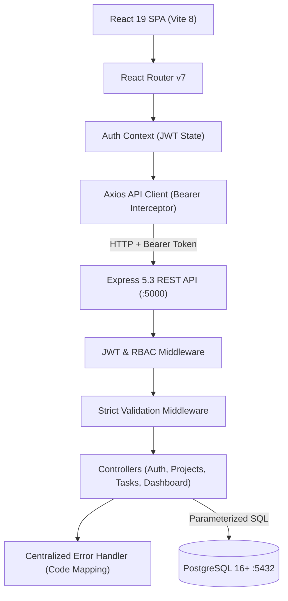
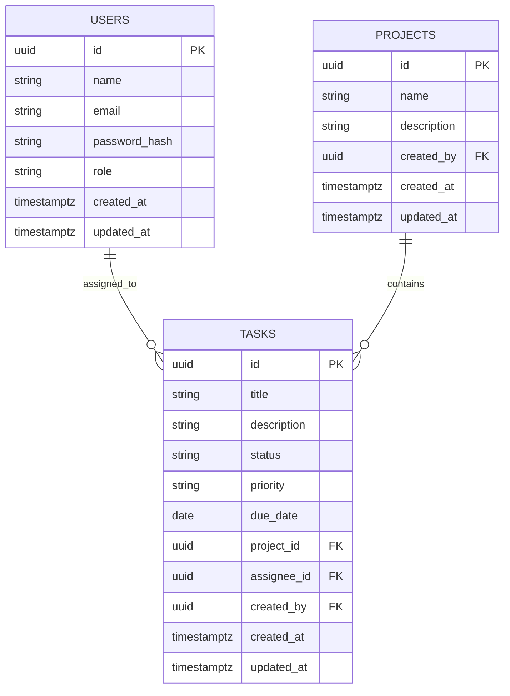

# Smart Task & Project Management System

[](https://nodejs.org/)
[](https://expressjs.com/)
[](https://www.postgresql.org/)
[](https://react.dev/)
[](https://vitejs.dev/)
[](LICENSE)

An enterprise-grade, full-stack Task and Project Management platform developed for the **Bright Mind Ltd. Full-Stack Developer Assessment**. Designed with a performance-first PostgreSQL schema, secure JWT Role-Based Access Control (RBAC), atomic analytical metric queries, and an executive Midnight Navy UI with mobile-responsive navigation.

---

## Table of Contents
- [System Architecture](#system-architecture)
- [Key Features](#key-features)
- [Tech Stack](#tech-stack)
- [Database Schema & Design](#database-schema--design)
- [Pre-Seeded Accounts](#pre-seeded-accounts)
- [Getting Started](#getting-started)
  - [Prerequisites](#prerequisites)
  - [Backend Setup & Database Migration](#1-backend-setup--database-migration)
  - [Frontend Setup](#2-frontend-setup)
- [Running Automated Tests](#running-automated-tests)
- [API Reference Overview](#api-reference-overview)
- [Project Structure](#project-structure)
- [Assessment Deliverables](#assessment-deliverables)

---

## System Architecture



---

## Key Features

### 1. Robust Authentication & RBAC
- **Password Security**: Passwords hashed using `bcryptjs` (10 salt rounds).
- **Session Tokens**: Stateless JSON Web Tokens (JWT) signed with HMAC-SHA256 and expiration.
- **Role Enforcement**:
  - **`admin`**: Full administrative access — create/update/delete projects, assign tasks to any employee, manage task lifecycle, and view executive metrics.
  - **`member`**: Focused team access — view projects (read-only), view tasks, and independently update task completion status (`To Do` -> `In Progress` -> `Completed`) on their assigned work. Attempting to modify other fields returns a `403 Forbidden` error.

### 2. Project Portfolio Management
- Real-time dynamic completion percentage computation (`COUNT(*) FILTER (WHERE status = 'Completed') / total * 100`).
- Relational cascading deletion (`ON DELETE CASCADE`) to eliminate orphaned task records upon project deletion.

### 3. Advanced Task Lifecycle & Filtering
- Categorized by **Status** (`To Do`, `In Progress`, `Completed`) and **Priority** (`Low`, `Medium`, `High`).
- **Multi-Field Real-Time Filtering**: Live server-side filtering combining project, status, priority, assignee, text search, and overdue toggles. Accepts both camelCase (`projectId`, `assigneeId`) and snake_case (`project_id`, `assignee_id`) query parameters.
- **Relational Integrity**: Foreign key to assignees (`ON DELETE SET NULL`) preserves tasks when team members are removed.
- **Nullable Field Clearing**: Updating tasks with `due_date: null` or `description: null` explicitly clears the database record using SQL `CASE WHEN` logic.

### 4. Executive Dashboard & Metrics
- **Zero N+1 Roundtrips**: Aggregated in a **single database query** using SQL subqueries and conditional filtering (`total_projects`, `total_tasks`, `completed_tasks`, `pending_tasks`, `overdue_tasks`, `high_priority_pending`, `completion_rate`).
- **Overdue Task Tracking**: Dedicated alert banner and filter for tasks with past-due deadlines that are not yet completed, ordered by due date and ranked priority (`High` > `Medium` > `Low`).

### 5. Polished Executive UI & Responsive Design
- Built on a **Deep Midnight Navy & Ice Slate** theme (`#0A1931` and `#F6FAFD`) designed for enterprise operational clarity.
- Fixed `100vh` non-scrolling sidebar on desktop with independent scrollable tables, and a sliding drawer with hamburger menu on mobile devices (<=768px).
- Debounced search input (~300ms) with stale-response cancellation and bidirectional URL parameter synchronization.
- Dot-style semantic badges and quick demo-fill buttons for instant reviewer evaluation.

---

## Tech Stack

| Layer | Technology | Key Libraries / Modules |
|---|---|---|
| **Frontend** | React 19.3, Vite 8.3 | `react-router-dom` v7, `axios`, `lucide-react`, Vanilla CSS Tokens |
| **Backend** | Node.js (v20+), Express 5.3 | `pg` (Connection Pooling), `jsonwebtoken`, `bcryptjs`, `cors`, `dotenv` |
| **Database** | PostgreSQL 16+ / 17 | Relational DDL, UUID v4 (`gen_random_uuid()`), B-Tree Indexes, Dynamic Interval Seeds |
| **Testing** | Node.js Test Runner | Native Integration Test Suite (`node:test`, `node:assert`) |

---

## Database Schema & Design

The database schema is strictly normalized and enforced with database-level constraints:



### Strategic B-Tree Indexes
- `idx_projects_created_by`: Foreign key index for project creator queries.
- `idx_tasks_project_id`: Fast joins and cascading deletes on project tasks.
- `idx_tasks_assignee_id`: Fast filtering by assigned team member.
- `idx_tasks_status`: Accelerated aggregation for status filtering and KPI metrics.
- `idx_tasks_priority`: Priority-based sorting and filtering.
- `idx_tasks_due_date`: Instant overdue task detection (`due_date < CURRENT_DATE`).

---

## Pre-Seeded Accounts

The database migration seeds **7 users**, **3 realistic projects**, and **14 tasks** (including 3 dynamically overdue tasks):

| Role | Name | Email | Password | Access Rights |
|---|---|---|---|---|
| **Admin** | Alex Turner | `alex.admin@brightmind.com` | `password123` | Full administrative control (CRUD projects, tasks, assign to all members, view KPIs) |
| **Admin** | Rachel Adams | `rachel.pm@brightmind.com` | `password123` | Full administrative control |
| **Member** | John Smith | `john.dev@brightmind.com` | `password123` | View projects & tasks, update status on assigned tasks |
| **Member** | Sarah Connor | `sarah.dev@brightmind.com` | `password123` | View projects & tasks, update status on assigned tasks |
| **Member** | Michael Scott | `michael.qa@brightmind.com` | `password123` | View projects & tasks, update status on assigned tasks |
| **Member** | Emma Watson | `emma.ui@brightmind.com` | `password123` | View projects & tasks, update status on assigned tasks |
| **Member** | David Miller | `david.ops@brightmind.com` | `password123` | View projects & tasks, update status on assigned tasks |

> **Tip**: One-click **"Fill Admin"** and **"Fill Team Member"** buttons are available on the Login page for instant reviewer access.

---

## Getting Started

### Prerequisites
- **Node.js**: v20.19+ or v22+ LTS ([Download](https://nodejs.org/))
- **PostgreSQL**: v14, v16, or v17 ([Download](https://www.postgresql.org/))
- **npm**: v10+ (bundled with Node)
- **Git** ([Download](https://git-scm.com/))

---

### 1. Backend Setup & Database Migration

1. **Navigate to the backend directory**:
   ```bash
   cd backend
   ```

2. **Install dependencies**:
   ```bash
   npm install
   ```

3. **Configure Environment Variables**:
   Copy the provided `.env.example` file to create your `.env`:
   ```bash
   cp .env.example .env
   ```
   *(On Windows PowerShell: `Copy-Item .env.example .env`)*

   Verify or update the connection settings in `backend/.env`:
   ```env
   PORT=5000
   NODE_ENV=development
   DB_HOST=localhost
   DB_PORT=5432
   DB_NAME=bm_task_manager
   DB_USER=postgres
   DB_PASSWORD=postgres
   JWT_SECRET=super_secret_brightmind_jwt_key_2026_recruitment
   JWT_EXPIRES_IN=7d
   CLIENT_URL=http://localhost:5173
   ```

4. **Initialize Database & Seed Data**:
   Ensure PostgreSQL is running locally. You can create the database manually via:
   ```bash
   createdb bm_task_manager
   ```
   *(Or in psql: `CREATE DATABASE bm_task_manager;`)*

   Then execute the automated initialization script:
   ```bash
   npm run init-db
   ```
   > **Note**: `initDb.js` will automatically connect to your PostgreSQL instance, create the `bm_task_manager` database if it does not already exist, execute the DDL schema (dropping and recreating tables cleanly), and insert all pre-seeded accounts and tasks.

5. **Start Backend Server**:
   ```bash
   npm run dev
   ```
   The API server will listen on `http://localhost:5000` with PostgreSQL connected.

---

### 2. Frontend Setup

1. **Open a new terminal and navigate to the frontend directory**:
   ```bash
   cd frontend
   ```

2. **Install dependencies**:
   ```bash
   npm install
   ```

3. **Start Vite Development Server**:
   ```bash
   npm run dev
   ```
   The application will be live at `http://localhost:5173`.

---

## Running Automated Tests

The backend includes a comprehensive 25-assertion integration test suite built with Node's native test runner (`node:test`, `node:assert`). It starts an in-process HTTP server and tests actual network round-trips and database mutations.

Run the test suite from the `backend/` directory:
```bash
npm test
```

### Test Coverage Highlights:
- **Authentication**: Valid login, bad password rejection (401), invalid/forged JWT rejection (401), missing token guard (401).
- **Privilege Escalation Prevention**: Registering with `role: "admin"` strictly creates a member account (201).
- **Input Validation**: Rejection of invalid calendar dates like `"2026-02-31"` (400), non-ISO dates `"10/05/2026"` (400), whitespace titles (400), overlong titles >200 chars (400), and empty string due dates (400).
- **Role-Based Access Control (RBAC)**:
  - Member cannot create a project (403).
  - Member cannot delete a project (403).
  - Member cannot create a task (403).
  - Member cannot delete a task (403).
  - Member cannot update task title or priority (403).
  - Member cannot update status on another member's task (403).
  - Member **can** update status on their assigned task (200).
- **CRUD & Field Clearing**:
  - Admin creates project and task.
  - Admin updates task clearing `due_date: null` and `description: null`, verifying values become `null` in PostgreSQL.
  - Cascading deletion: deleting a project deletes all associated child tasks.
- **Filtering & Dashboard**: Multi-field query filtering with support for both `projectId`/`project_id` and `assigneeId`/`assignee_id`, overdue filter, and KPI metric aggregations.

---

## API Reference Overview

Base URL: `http://localhost:5000/api`

| Method | Endpoint | Required Role | Description |
|---|---|---|---|
| `GET` | `/health` | Public | System uptime and health status |
| `POST` | `/auth/register` | Public | Register new team member account |
| `POST` | `/auth/login` | Public | Authenticate user and receive JWT |
| `GET` | `/auth/me` | Authenticated | Retrieve authenticated session profile |
| `GET` | `/auth/users` | Authenticated | List all registered users for task assignment |
| `GET` | `/dashboard` | Authenticated | Retrieve system KPIs, overdue alerts, and progress |
| `GET` | `/projects` | Authenticated | List all projects with computed task completion rates |
| `GET` | `/projects/:id` | Authenticated | Get project details and all child tasks |
| `POST` | `/projects` | Admin | Create new project |
| `PUT` | `/projects/:id` | Admin | Update project name or description |
| `DELETE` | `/projects/:id` | Admin | Delete project (cascades to all associated tasks) |
| `GET` | `/tasks` | Authenticated | Multi-field task filtering, search, and overdue filter |
| `GET` | `/tasks/:id` | Authenticated | Get single task details |
| `POST` | `/tasks` | Admin | Create new task linked to project & assignee |
| `PUT` | `/tasks/:id` | Admin / Member | Admins update any field; Members update status on assigned tasks |
| `DELETE` | `/tasks/:id` | Admin | Delete task |

> For comprehensive request/response payloads, field schemas, and cURL examples, see [`docs/API_DOCUMENTATION.md`](docs/API_DOCUMENTATION.md).

---

## Project Structure

```
bm-task-manager/
├── backend/
│   ├── src/
│   │   ├── config/
│   │   │   ├── env.js           # Centralized environment validator
│   │   │   └── db.js            # PostgreSQL connection pool (pg.Pool)
│   │   ├── controllers/
│   │   │   ├── authController.js       # Authentication & user directory
│   │   │   ├── dashboardController.js  # Atomic single-query KPI aggregations
│   │   │   ├── projectController.js    # Projects CRUD with progress percentages
│   │   │   └── taskController.js       # Tasks CRUD, RBAC, and clearing null fields
│   │   ├── db/
│   │   │   ├── initDb.js        # Resilient automated DB creator & runner
│   │   │   ├── schema.sql       # PostgreSQL DDL with constraints and indexes
│   │   │   └── seed.sql         # Seed data with relative CURRENT_DATE intervals
│   │   ├── middleware/
│   │   │   ├── authMiddleware.js       # JWT verification & requireAdmin RBAC
│   │   │   ├── errorHandler.js         # PostgreSQL code mapper (22001, 22007 -> 400)
│   │   │   └── validateMiddleware.js   # Strict regex & ISO calendar date validation
│   │   ├── routes/              # Express route definitions
│   │   ├── app.js               # Express application configuration
│   │   └── server.js            # Server entrypoint with graceful shutdown
│   ├── .env.example             # Documented template without committed secrets
│   ├── package.json
│   └── test-api.js              # 25-assertion Node.js native test suite
│
├── frontend/
│   ├── src/
│   │   ├── api/                 # Axios HTTP client with Bearer interceptor
│   │   ├── components/common/   # Badge, Modal, Navbar, Sidebar (Drawer), Layout
│   │   ├── context/             # AuthContext (JWT rehydration, login, logout)
│   │   ├── pages/               # DashboardPage, ProjectsPage, TasksPage, LoginPage, RegisterPage
│   │   ├── routes/              # ProtectedRoute with role enforcement and redirect state
│   │   ├── index.css            # Midnight Navy design system & responsive media queries
│   │   └── main.jsx             # React 19 entrypoint
│   ├── index.html               # Semantic HTML5 shell with descriptive title
│   ├── eslint.config.js         # ESLint 10 configuration (0 errors, 0 warnings)
│   ├── package.json
│   └── vite.config.js
│
├── docs/
│   ├── API_DOCUMENTATION.md     # Complete REST API reference with real payloads
│   └── AI_USAGE_REPORT.md       # Mandatory 1-page engineering reflection report
├── LICENSE                      # MIT License
└── README.md
```

---

## Assessment Deliverables

- **REST API Documentation**: [`docs/API_DOCUMENTATION.md`](docs/API_DOCUMENTATION.md)
- **1-Page AI Reflection Report**: [`docs/AI_USAGE_REPORT.md`](docs/AI_USAGE_REPORT.md)
- **Automated Test Suite**: [`backend/test-api.js`](backend/test-api.js) (`npm test`)
